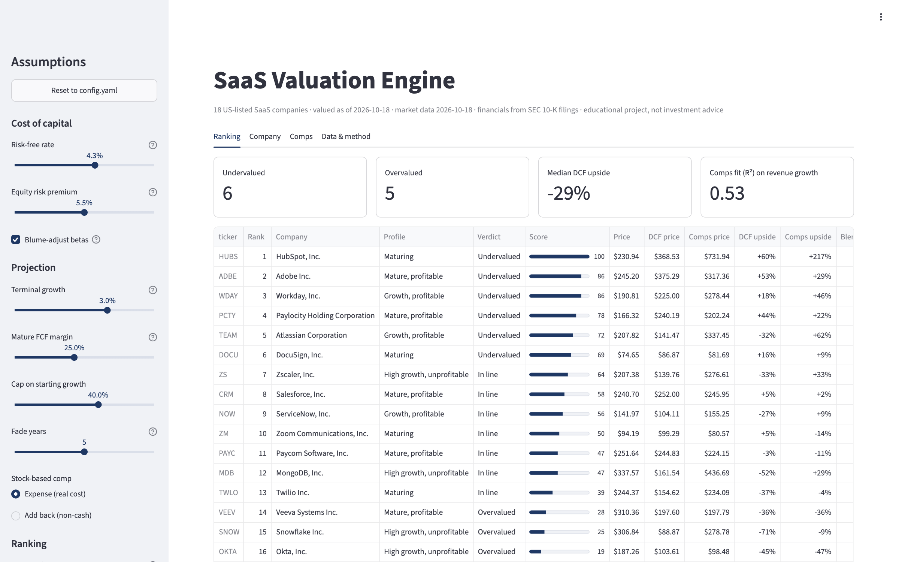
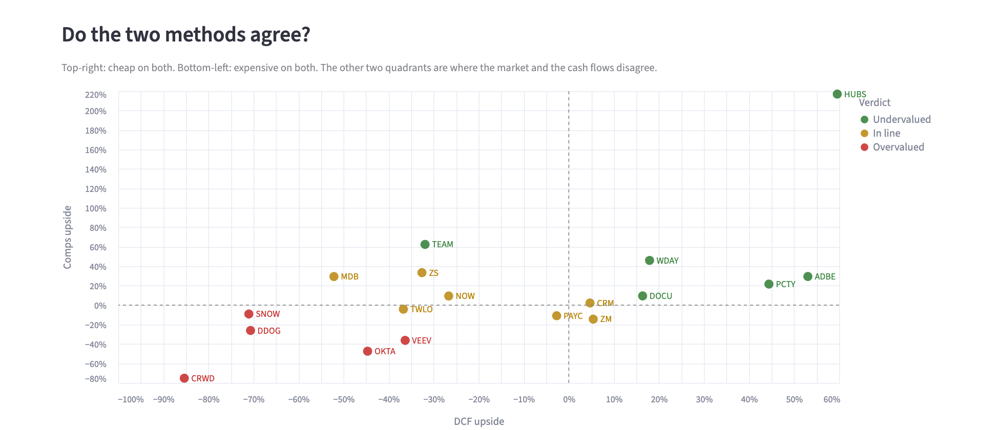
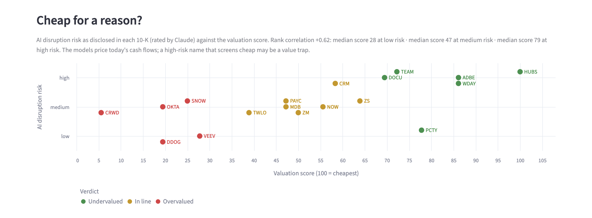
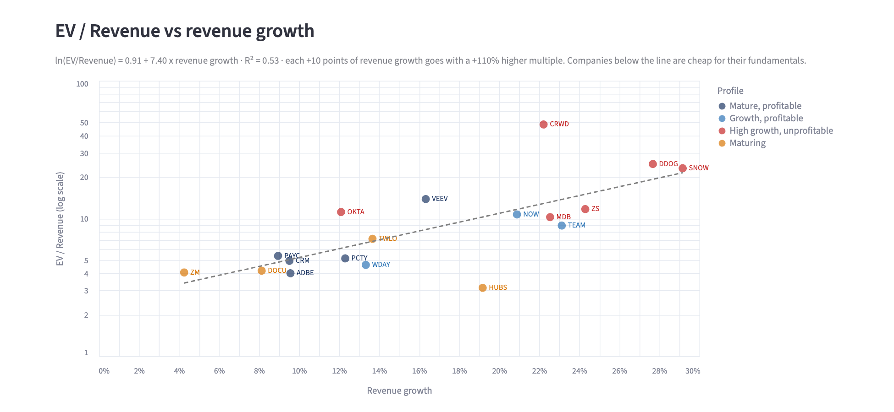
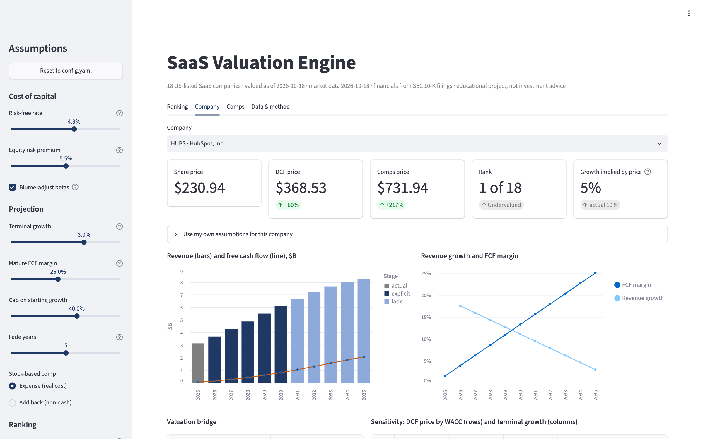
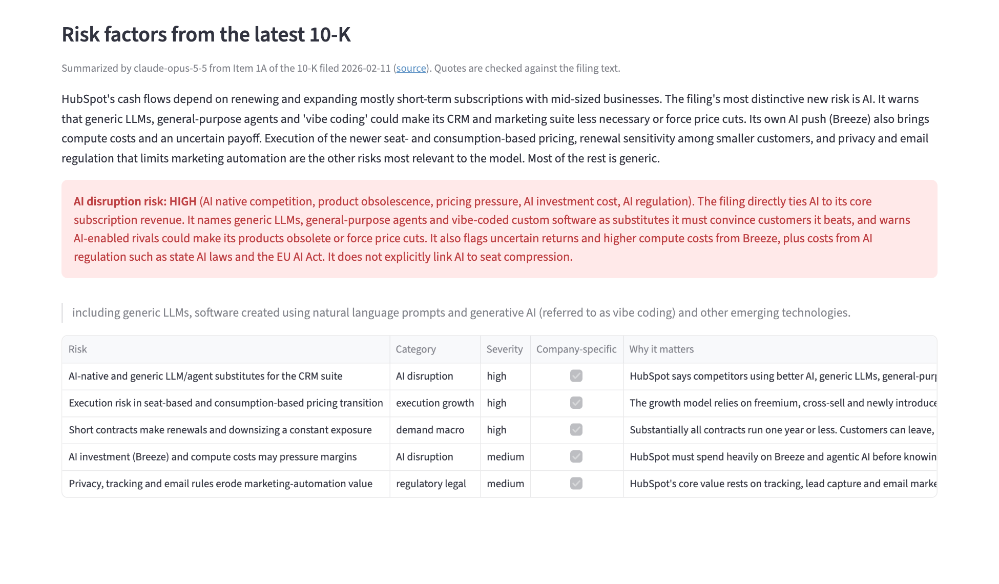

# SaaS Valuation Engine

A Python tool that values 18 US-listed SaaS companies from their SEC filings. It values each one two ways, with a two-stage DCF and a regression-adjusted trading comps model, and ranks them from most undervalued to most overvalued. An optional AI layer then reads each 10-K's Risk Factors to test whether the stocks that look cheap are cheap for a reason.

Everything comes from primary sources: XBRL financials from SEC EDGAR, prices from Yahoo Finance and risk factors from the 10-K text. Every assumption is in one config file and can be changed live in a Streamlit dashboard.



*Prices as of 18 Oct 2026; financials calendarized to CY2025. Educational project, not investment advice.*

---

## Key findings

**1. The two methods agree on the extremes.** HubSpot, Adobe, Workday, Paylocity and DocuSign screen cheap on both the DCF and comps. CrowdStrike, Datadog, Snowflake, Okta and Veeva screen expensive on both.



**2. The reverse DCF shows what each price assumes.** Solving for the starting revenue growth that makes the DCF equal today's price gives:

| | Growth implied by price | Actual CY2025 growth | Read |
|---|---|---|---|
| CrowdStrike | 86% | 22% | Price needs growth to nearly quadruple |
| Snowflake | 67% | 29% | Price needs growth to more than double |
| Adobe | −2% | 10% | Price assumes revenue shrinks |
| Paylocity | 3% | 12% | Price assumes growth stalls |

**3. The cheap stocks are the ones most exposed to AI.** Claude rated the AI disruption risk each company discloses in its own 10-K.
- 5 of the 6 "undervalued" companies rate **high**. None of the 5 "overvalued" ones do.
- The rank correlation between AI risk and the valuation score is **+0.62**.
- The undervalued group (Adobe, HubSpot, Workday, Atlassian, DocuSign) sells per-seat tools for knowledge workers. Their filings name generic LLMs, AI agents and "vibe-coded" software as substitutes.
- The expensive group is security and data infrastructure, where AI tends to add demand rather than replace it.



**What that means:** a DCF built on today's growth and margins can't see a threat that hasn't reached the numbers yet. The market appears to be pricing one in. Whether it's right is the investment question; the models alone can't call a "cheap" name like HubSpot or Adobe a buy without an answer to it.

---

## How it works

```
SEC EDGAR (XBRL)  ─┐
                   ├─► Data pipeline ─► Comps ─┐
Yahoo Finance     ─┘   (clean, tag,     (Stage 3) ├─► Ranking ─► Excel workbooks
                       split-adjust)  ─► DCF ─────┘   (Stage 5)   Streamlit dashboard
SEC 10-K text  ──────► Item 1A ─► Claude risk summary (Stage 7) ──┘
```

### 1. Data pipeline
- Five years of annual financials from the SEC's XBRL `companyfacts` API, including revenue, gross profit, operating income, D&A, SBC, operating cash flow, capex, capitalized software, cash, investments, debt and diluted shares.
- **Tag handling.** Companies report the same item under different XBRL tags, and sometimes switch tags between years. Each concept has a priority list of tags, and every number records which tag it came from.
- **Stock splits** are detected and every earlier share count is restated to today's basis, so a split is never mistaken for dilution. CrowdStrike (4:1) and ServiceNow (5:1) split inside the data window.
- **Dual-class companies** (Atlassian, Workday) are valued on market cap ÷ price, because the share count from data providers covers only one class.
- **Gaps are flagged, not guessed.** Every issue goes into a ranked data-quality report. The six values the SEC's standardized dataset doesn't carry were taken from the filings' own custom XBRL tags and entered in `config.yaml`, each with the filing it came from.

### 2. Trading comps
- EV/Revenue, EV/EBITDA, P/FCF, growth, gross and FCF margins, SBC as % of revenue, and Rule of 40.
- Fiscal years end anywhere from January to December, so every flow metric is **calendarized** to CY2025.
- Enterprise value bridges from market cap through debt, cash and short-term investments.
- Multiples on negative earnings, or above 100x, are reported as NM (not meaningful) rather than as misleading numbers.

### 3. DCF
- **Two stages:** 5 explicit years, then 5 fade years in which growth glides to a 3% terminal rate and FCF margins converge to a mature level.
  - A plain 5-year model forces every company to 3% growth by year 5 and gives them all the same ~3-4x terminal multiple. That erases the premium for growth; the fade stage fixes it.
- **Discount rate:** WACC, with the cost of equity from CAPM using Blume-adjusted betas.
- **Mechanics:** mid-year discounting, a Gordon growth terminal value, and a roll-forward to the valuation date.
- **Stock-based comp is treated as a real expense.** It is employee pay delivered in shares. Adding it back flatters every company in this sector.
- **Outputs:** a WACC × terminal growth sensitivity grid per company, and a reverse DCF that solves for the growth the market price implies.

### 4. Ranking
- **Comps signal.** Raw multiples mislead, because faster growers deserve higher ones. Instead, ln(EV/Revenue) is regressed on revenue growth across the peer group.
  - Growth explains 53% of the variation in multiples, against 29% for Rule of 40 and 1% for FCF margin, so growth is the regressor.
  - Each company's fair multiple comes from a line fitted on the *other* 17 (leave-one-out), so an outlier can't set its own benchmark.



- **Combined score:** DCF upside and comps upside are converted to percentile ranks and averaged 50/50 into a 0–100 score. The ranking flags every company where the two signals disagree.

### 5. Dashboard
- Built in Streamlit; it re-runs all 18 valuations whenever you move a slider: rates, terminal growth, mature margins, fade length, SBC treatment, ranking weights.
- You can set your own growth, margin and beta for any single company. The re-ranking includes your view.
- It uses the same model code as the command-line scripts, so its results always match the Excel outputs.



### 6. AI risk layer (optional)
- Claude Opus 5.5 reads Item 1A of each company's latest 10-K, 374,000 words in total.
- It returns schema-validated JSON: a summary, the five most material risks (marked company-specific or boilerplate), and an AI disruption rating with the mechanism behind it.
- **Every quote is checked word-for-word against the filing.** In the full run, 107 of 108 quotes matched. The one paraphrase was flagged, not hidden.
- Results are cached per filing. A full run cost $3.85.



---

## Outputs

The `outputs/` folder holds a snapshot of every workbook, so you can open the models without running anything:

| Workbook | Contents |
|---|---|
| [`comps_CY2025.xlsx`](outputs/comps_CY2025.xlsx) | Comps table, summary stats by profile, EV bridge, calendarization, stock splits, overrides, methodology |
| [`dcf_models.xlsx`](outputs/dcf_models.xlsx) | Summary plus one sheet per company: 10-year projection, valuation bridge, colour-coded sensitivity grid |
| [`ranking.xlsx`](outputs/ranking.xlsx) | Final ranking, comps regression with chart, methodology |
| [`risk_summaries.xlsx`](outputs/risk_summaries.xlsx) | AI risk vs valuation verdict, top 5 risks per company with verified quotes, run log |

## Run it yourself

Requires Python 3.12+.

```bash
git clone https://github.com/ranabrahami/saas-valuation-engine.git
cd saas-valuation-engine
python3.12 -m venv .venv && source .venv/bin/activate
pip install -e ".[dashboard]"            # add ,ai for the risk layer, ,dev for tests
cp .env.example .env                     # the SEC asks for a name and email in the User-Agent
```

```bash
python -m saas_valuation.data.pipeline    # fetch and clean data (cached; --refresh to re-download)
python -m saas_valuation.models.comps     # -> outputs/comps_CY2025.xlsx
python -m saas_valuation.models.dcf       # -> outputs/dcf_models.xlsx
python -m saas_valuation.models.ranking   # -> outputs/ranking.xlsx
streamlit run dashboard/app.py            # dashboard at http://localhost:8501

# Optional, needs ANTHROPIC_API_KEY in .env (about $4 for all 18):
python -m saas_valuation.models.risk --estimate   # exact token count and cost, nothing billed
python -m saas_valuation.models.risk              # asks before spending
```

To change any assumption, edit [`config/config.yaml`](config/config.yaml): the universe, WACC inputs, terminal growth, fade length, SBC treatment, ranking weights and verdict thresholds all live there. Run `pytest` for the 45 tests, which cover the data pipeline, models, AI layer (with a fake client, so nothing is billed) and the dashboard in a real browser.

## Limitations

- **18 companies is a small sample.** The comps regression (R² 0.53) is a useful benchmark, not a precise one.
- **Annual data only.** Balance sheets are from the latest 10-K, not the latest 10-Q, so net cash can be up to a year old.
- **The DCF is formula-driven.** Every company gets the same fade shape and terminal assumptions unless you override it in the dashboard. It is a screen, not a substitute for company-specific forecasts.
- **Missing older data.** Some pre-2025 values aren't in the SEC's standardized dataset: Veeva capex FY2022–24, and D&A for a few companies. They are flagged in the data quality report. They don't affect the CY2025 valuation, which uses only the latest two fiscal years.
- **AI ratings are an LLM's reading of company disclosures.** Every quote is verified, but the ratings themselves are judgments, and companies vary in how candidly they write risk factors.

## Project structure

```
config/config.yaml         Every assumption, with comments explaining each choice
src/saas_valuation/
  data/                    SEC client, XBRL extraction, prices, splits, overrides, 10-K text
  models/                  comps, dcf, ranking, risk (AI layer)
  reports/                 Excel workbook builders
dashboard/app.py           Streamlit dashboard
scripts/screenshots.py     Regenerates the images in this README
tests/                     pytest suite
outputs/                   Excel snapshot
```

## Disclaimer

Educational project. Not investment advice. Data from public SEC filings and Yahoo Finance; check against the filings before relying on any figure.
