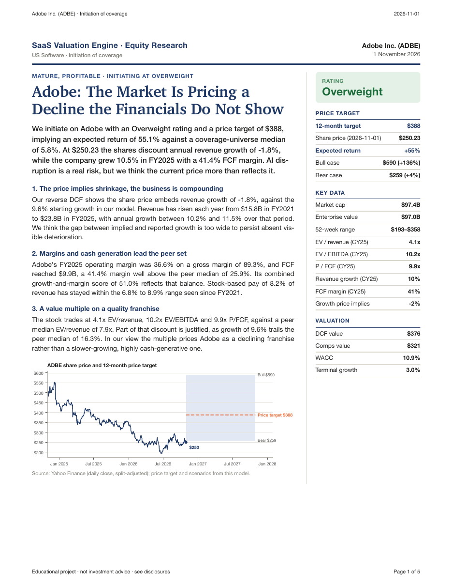
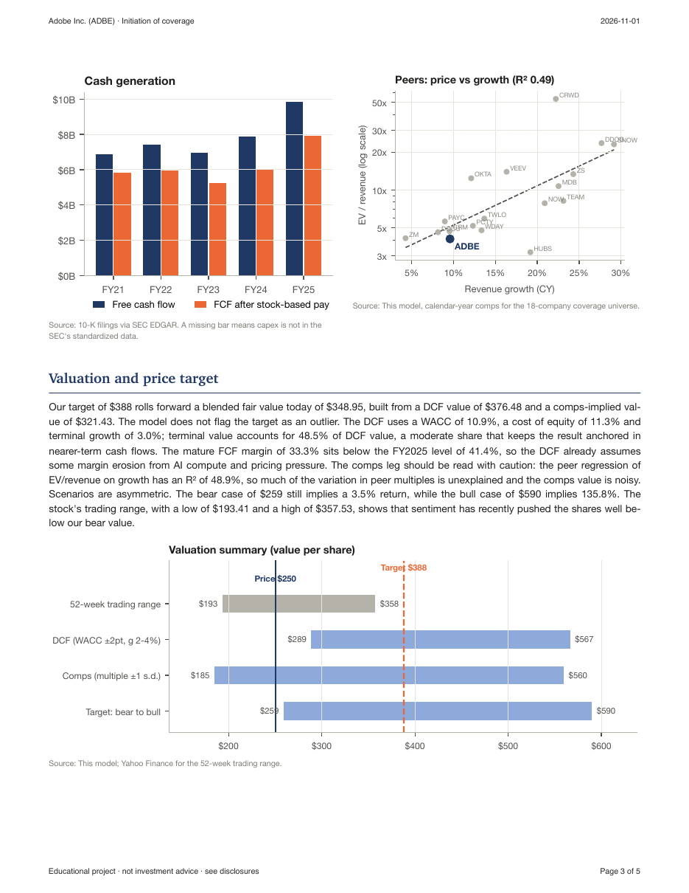
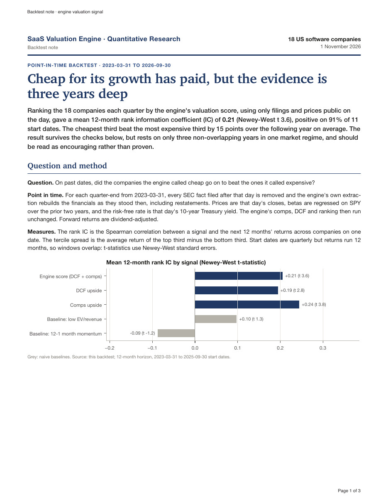
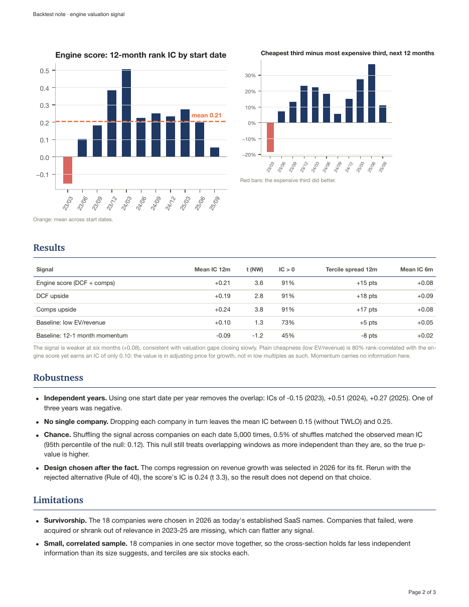

# SaaS Valuation Engine

**Institutional-style equity research generated from SEC filings, plus a point-in-time backtest of whether its valuation signal works.**

The engine values 18 US-listed software companies from their 10-K filings:
- **Valuation:** a two-stage DCF and growth-adjusted trading comps.
- **Ratings:** each company gets an Overweight / Neutral / Underweight rating, a 12-month price target and bull/bear cases.
- **Reports:** a five-page PDF initiation report per company, its narrative written by Claude under an automatic check that every number traces to the data.
- **Backtest:** rebuilds the engine's inputs as they stood on past dates, to test whether "cheap" names went on to outperform.

| Sample reports | Rating | Why it's interesting |
|---|---|---|
| [Adobe](docs/samples/ADBE_initiation_2026-11-01.pdf) | Overweight | The clean case: the price implies shrinking revenue; the company grows ~10% with a 41% FCF margin |
| [HubSpot](docs/samples/HUBS_initiation_2026-11-01.pdf) | Overweight, **flagged outlier** | The report explains why the model's +158% target shouldn't be taken at face value |
| [Zoom](docs/samples/ZM_initiation_2026-11-01.pdf) | Neutral | Priced roughly where the models put it |
| [Snowflake](docs/samples/SNOW_initiation_2026-11-01.pdf) | Underweight | The risks listed are *upside* risks, as a real Underweight requires |
| [Backtest note](docs/samples/backtest_note.pdf) | — | Does the signal predict returns? Method, results, robustness, limitations |

<p>


</p>

*Prices as of 1 November 2026. Educational project, not investment advice.*

---

## Key findings

### 1. Cheap-for-its-growth predicted returns, but the evidence is three years deep
Each quarter since March 2023, the 18 companies were ranked by the engine's score using **only filings and prices public on that day**, then compared with their returns over the next 12 months.

| Signal | Mean 12-month rank IC | t (Newey-West) | Cheapest third minus most expensive third |
|---|---|---|---|
| **Engine score (DCF + comps)** | **+0.21** | 3.6 | **+15 pts a year** |
| Comps upside | +0.24 | 3.8 | +17 pts |
| DCF upside | +0.19 | 2.8 | +18 pts |
| Baseline: low EV/revenue | +0.10 | 1.3 | +5 pts |
| Baseline: 12-1 month momentum | −0.09 | −1.2 | −8 pts |

- **The value is in the growth adjustment.** Plain cheapness is 80% rank-correlated with the engine's score but earns half the IC. The signal works as "cheap *for its growth*", not "cheap".
- **It survives attempts to break it.** Dropping any one company leaves the IC between 0.15 and 0.25. A permutation test gives p ≈ 0.005, which overstates certainty because overlapping windows aren't independent. The comps design rejected in 2026 (Rule of 40) does just as well (IC 0.24), so the result isn't an artifact of choosing the design after seeing the data.
- **But treat it as encouraging, not proven.** There are only three non-overlapping years (ICs −0.15, +0.51, +0.27), one regime (2023–26) and today's survivors (the companies were chosen in 2026).

<p>


</p>

### 2. The reverse DCF shows what each price assumes
Solving for the starting revenue growth that makes the DCF equal today's price:

| | Growth the price implies | Actual calendar-2025 growth | Read |
|---|---|---|---|
| CrowdStrike | 89% | 22% | Needs growth to roughly quadruple → Underweight, flagged outlier |
| Snowflake | 66% | 29% | Needs growth to more than double → Underweight |
| HubSpot | 6% | 19% | Prices in a sharp slowdown → Overweight |
| Adobe | −2% | 10% | Prices in shrinking revenue → Overweight |

### 3. The cheap stocks are the ones most exposed to AI
Claude rated the AI disruption risk each company discloses in its own 10-K (Item 1A).
- Four of the six "undervalued" names rate **high**. None of the five "overvalued" ones do.
- The rank correlation between AI risk and the valuation score is +0.59.
- The cheap group sells per-seat tools for knowledge workers. The expensive group is security and data infrastructure, where AI adds demand.

A DCF built on today's numbers can't see a threat that hasn't reached them yet, and the reports say so in their risk sections. The backtest covers 2023–26, when this rotation was under way, which is one more reason not to over-read it.

---

## How it works

```
SEC EDGAR XBRL ──► data pipeline ──► comps ──┐
Yahoo Finance  ──►  (tags, splits,   DCF  ──┼──► ranking ──► price target, scenarios, rating
                     restatements)          │                          │
10-K text ──────► Item 1 + Item 1A ──► Claude risk summary            │
                                                                       ▼
                         charts + Claude narrative (number-checked) ──► PDF report
point-in-time rebuild of all of the above ──────────────────────────► backtest note
```

| Step | What it does | Code |
|---|---|---|
| **Data** | 5 years of 10-K financials from SEC companyfacts. A priority list of XBRL tags per concept, provenance for every number, stock splits restated, dual-class share counts handled. Gaps are flagged, never guessed. | `data/` |
| **Comps** | EV/revenue, EV/EBITDA, P/FCF, margins, Rule of 40. Every flow metric is calendarized to CY2025 because fiscal years end in different months. | `models/comps.py` |
| **DCF** | Two stages (5 explicit + 5 fade years). WACC from CAPM with Blume-adjusted betas, stock-based pay as a real cost, Gordon terminal value, sensitivity grid, and a reverse DCF. | `models/dcf.py` |
| **Ranking** | ln(EV/revenue) regressed on growth across peers, leave-one-out (R² 0.49). DCF and comps upside combined as percentile ranks. | `models/ranking.py` |
| **Target and rating** | Fair value = 50/50 DCF and comps, rolled forward 12 months at the cost of equity. Bull/bear cases shift growth and margin ±5 pts, and the comps multiple ±1 residual s.d. Ratings are relative to the coverage median (±15 pts). Targets beyond ±75% are **flagged, not capped**. | `models/target.py` |
| **AI risk** | Claude reads each 10-K's Item 1A and returns schema-validated JSON. Every quote is verified word-for-word against the filing. | `models/risk.py` |
| **Narrative** | Claude (Opus 5.5) writes the thesis, business overview, valuation discussion, risks and "what would change our view". It is given the rating as a fact it must not change, plus a 65-item tagged fact sheet. Every number in the text must trace to the facts, the 10-K or the risk summary; failures get one retry naming the problem, otherwise the draft is held back. | `research/narrative.py`, `research/grounding.py` |
| **PDF** | HTML template with print CSS, rendered by Chrome. Vector charts, and a methodology page generated from `config.yaml` so it always matches the model used. | `research/render.py` |
| **Backtest** | For each past quarter-end: SEC facts filtered to those filed by that day and re-extracted (restatements as of then), prices, two-year betas and the 10-year yield on the day. Then the unchanged engine. Rank ICs, tercile spreads, Newey-West t-stats, robustness checks. | `research/backtest.py` |

Every assumption lives in [`config/config.yaml`](config/config.yaml), with a comment explaining each choice. Excel workbooks with the full models are in [`outputs/`](outputs/), and an interactive Streamlit dashboard re-runs all valuations as you move the assumptions (`dashboard/app.py`).

## Lessons worth knowing (found by tests and by looking at the output)
- **"Filed" dates lie for backtests.** The standardized data keeps the date of the *latest* filing that reported a number, often a year after it was first published. The backtest rebuilds from every filed version instead.
- **A strict checker is only as good as its false positives.** The first full narrative run retried all 18 drafts. The cause was the checker reading "52-week" and "Rule of 40" as unsupported numbers. Logging *why* drafts were retried exposed it.
- **Silent rendering failures.** HTML-escaping the stylesheet dropped every font rule without an error, and integer market caps showed as "n/a". Both were found only by rendering and looking at the pages, and both now have tests.

## Run it yourself

Requires Python 3.12+ and Google Chrome (for the PDFs).

```bash
git clone https://github.com/ranabrahami/saas-valuation-engine.git
cd saas-valuation-engine
python3.12 -m venv .venv && source .venv/bin/activate
pip install -e ".[report,ai,dev]"         # add ,dashboard for the Streamlit app
cp .env.example .env                      # SEC User-Agent (name + email); ANTHROPIC_API_KEY for the AI steps
```

```bash
python -m saas_valuation.data.pipeline             # SEC + market data (cached)
python -m saas_valuation.models.comps              # comps        -> outputs/comps_CY2025.xlsx
python -m saas_valuation.models.dcf                # DCF          -> outputs/dcf_models.xlsx
python -m saas_valuation.models.ranking            # ranking      -> outputs/ranking.xlsx
python -m saas_valuation.models.target             # price targets, scenarios, ratings
python -m saas_valuation.models.risk --estimate    # AI risk summaries: free token count first, then run without --estimate
python -m saas_valuation.research.narrative --estimate   # report narratives: ~$0.20-0.25 per company
python -m saas_valuation.research.render           # PDFs         -> outputs/reports/<TICKER>/
python -m saas_valuation.research.backtest         # backtest     -> outputs/backtest/backtest_note.pdf
pytest                                             # 81 tests; AI steps use a fake client, nothing billed
```

The paid steps (risk summaries and narratives) show an exact token count and ask before spending. Results are cached, so re-running costs nothing until the data or prompts change.

## Limitations
- **18 companies in one sector.** The peer regression (R² 0.49) is a benchmark, not a precise fair value. In the backtest, terciles are six stocks each.
- **Backtest scope.** Three non-overlapping years, one regime, today's survivors. Returns are gross, equal-weighted, without costs. DCF parameters were set with today's knowledge; only the comps design was tested for sensitivity.
- **Annual data only.** Balance sheets come from the latest 10-K, so net cash can be up to a year old.
- **A formula-driven DCF.** It applies the same fade shape to every company and is harsh on fast growers, which is why CrowdStrike's target is flagged.
- **AI-written text is checked, not infallible.** Every number is verified against the sources, but qualitative judgments in the narrative and risk ratings are the model's reading of the filings.

## Project structure
```
config/config.yaml          every assumption, with the reasoning
src/saas_valuation/
  data/                     SEC client, XBRL extraction, prices, splits, overrides, 10-K sections
  models/                   comps, DCF, ranking, price targets, AI risk summaries
  reports/                  Excel workbook builders
  research/                 report data, charts, narrative + number checker, PDF rendering, backtest
    templates/              report and backtest-note HTML/CSS
dashboard/app.py            Streamlit dashboard
docs/samples/               sample report PDFs and the backtest note
tests/                      81 tests
```

## Disclaimer
Educational portfolio project. Not investment research from a regulated firm and not investment advice; nothing here is a recommendation to buy, sell or hold any security. Data from SEC EDGAR and Yahoo Finance; verify against the filings before relying on any figure.
